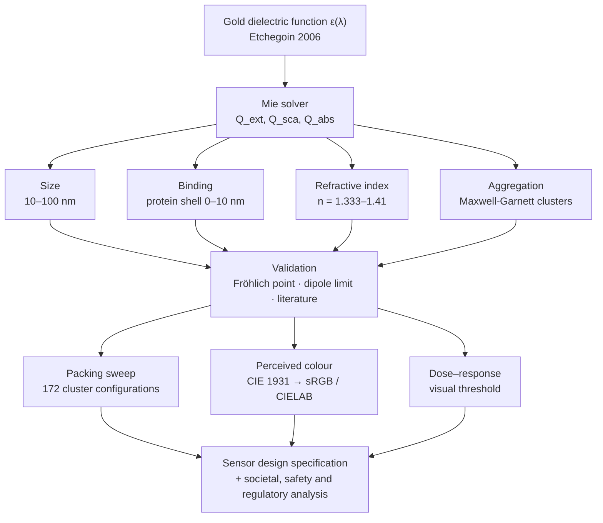
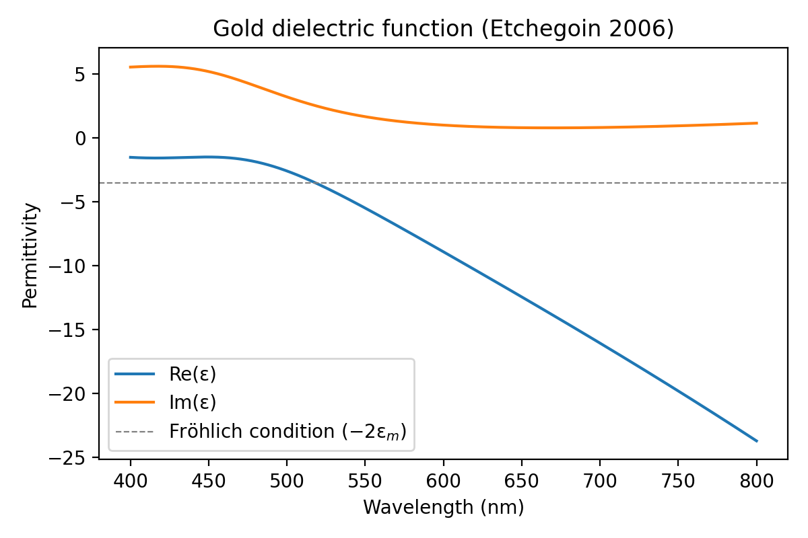
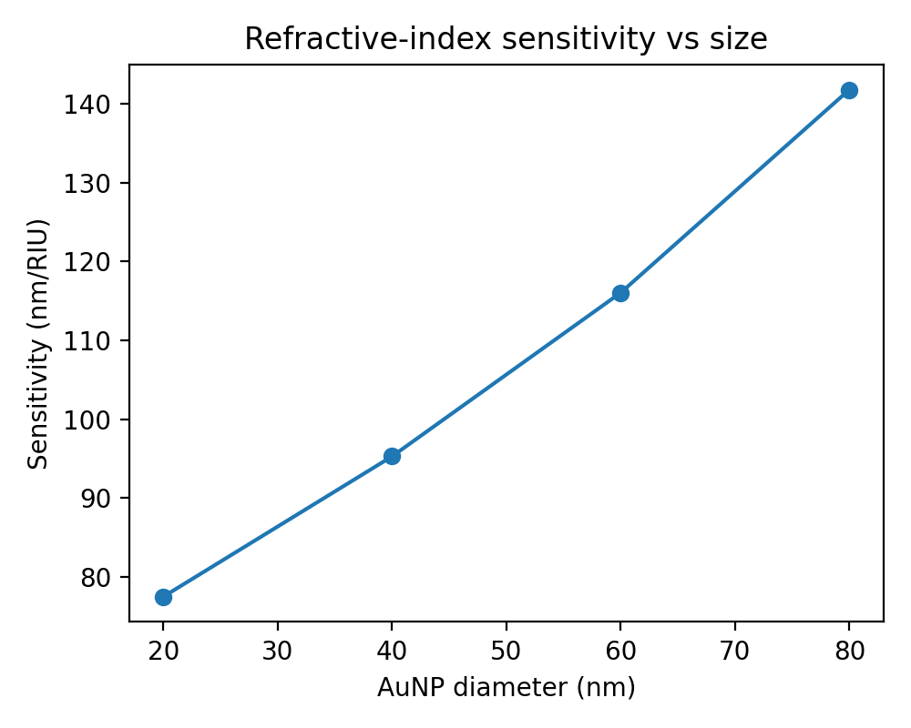
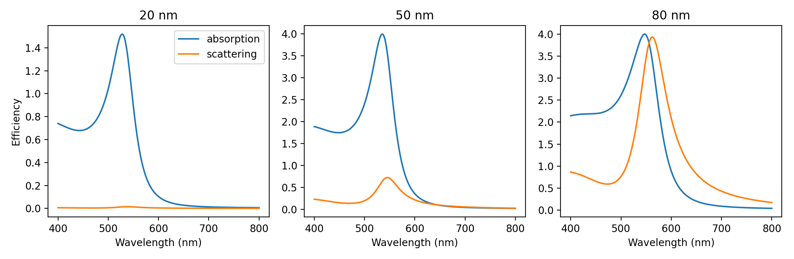
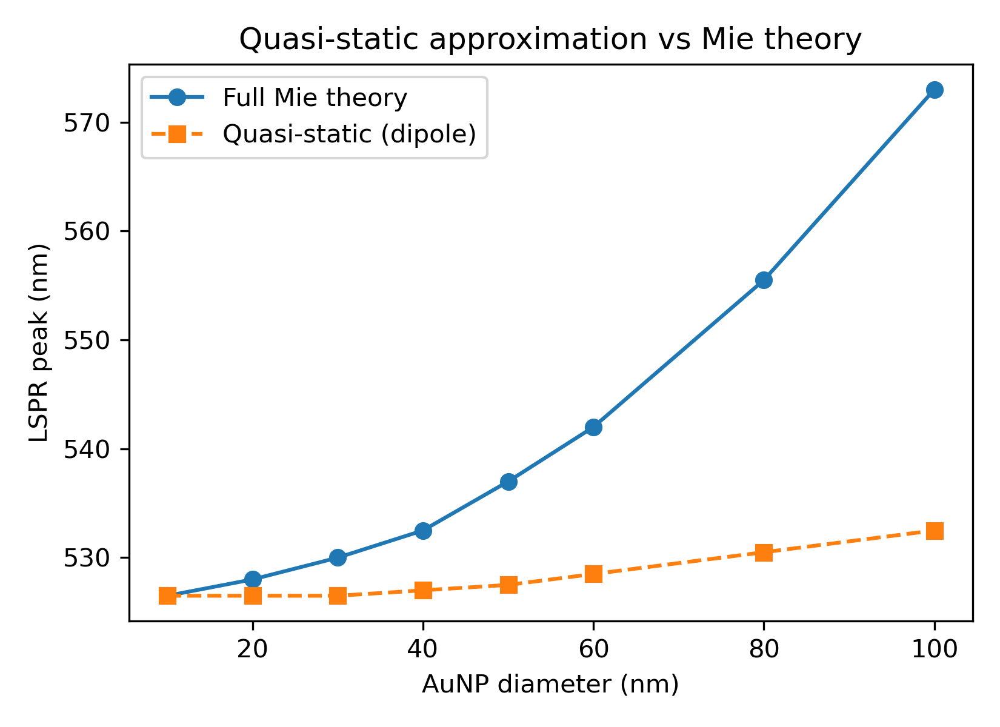

# NanoSense-AuNP

**Computational design of a gold-nanoparticle (AuNP) plasmonic colorimetric biosensor for low-cost point-of-care diagnostics**

A physics-based simulation study that answers a practical design question before any wet-lab work: *which gold-nanoparticle size, and which readout, give the strongest and most reliable colour signal for a paper-strip or single-tube diagnostic test, and how much of the gold has to aggregate before a person can see the change?*

Mini-project for **21NT0404T – Nanotechnology in Societal Development**, SRM Institute of Science and Technology, Kattankulathur.
Author: **Shreejan V** (RA2311070010025), B.Tech Biotechnology · Guide: **Dr. Karthika P C**, Department of Physics and Nanotechnology.

    

**[Full report (PDF, 30 pages)](report/report.pdf)** · **[Results](#results)** · **[Run it](#installation-and-usage)** · **[Design decisions](#design-decisions)**

---

## Highlights

- Built a **Mie-theory solver** from scratch in Python (Riccati–Bessel functions via SciPy) with an **analytical dielectric model of gold** (Etchegoin et al., 2006), and checked it against the dipole limit and published data.
- Ran **11 virtual experiments**: size, protein binding, refractive-index sensitivity, aggregation, dielectric validation, absorption vs scattering, sensitivity vs size, quasi-static vs Mie, a **172-configuration** cluster size × packing sweep, perceived colour, and a 101-point dose–response.
- Showed that **aggregation is the right readout** for a by-eye test: a **>130 nm** red-shift (528 → 663 nm) and a **~40-fold** rise in A620/A520, versus at most **7.5 nm** from protein binding alone.
- Identified **20–40 nm particles** as the best probe: sharp band, **<1%** of extinction from scattering at 20 nm (vs **49.8%** at 80 nm).
- Converted simulated spectra into **perceived colour** (CIE 1931 → sRGB / CIELAB). The model reproduces the red → blue change from first principles (hue 17° → 281°) and predicts the change becomes **just noticeable at ~2.6%** of the gold aggregated and **clearly visible at ~11.7%**.
- Found that the standard A620/A520 readout is **not monotonic in cluster size** and depends strongly on packing (max 1.77 at 160 nm for fill fraction 0.4), an important caveat for quantitative calibration.
- Wrote a **30-page project report** (25 references) covering theory, methods, results, validation, and the societal, safety, ethical and regulatory context in India.

## Project at a glance

| | |
|---|---|
| **Type** | Computational / simulation study (no wet lab) |
| **Domain** | Nanophotonics · plasmonics · colorimetric biosensing · point-of-care diagnostics |
| **Methods** | Mie theory, quasi-static (dipole) and core–shell polarizability, Maxwell-Garnett effective medium, Beer–Lambert absorbance, CIE colorimetry |
| **Code** | ~400 lines of Python in three scripts, 15 functions |
| **Stack** | Python 3.13, NumPy 2.4, SciPy 1.18 (`spherical_jn`, `spherical_yn`), Matplotlib 3.10 |
| **Outputs** | 11 figures, 2 results tables (CSV), 30-page report |
| **Runtime** | Seconds for the core study; about a minute for the full readout and colour analysis |

---

## Table of contents
1. [Background](#background)
2. [Problem statement and research questions](#problem-statement-and-research-questions)
3. [How the sensor works](#how-the-sensor-works)
4. [Approach](#approach)
5. [Physics and models](#physics-and-models)
6. [Implementation](#implementation)
7. [Repository structure](#repository-structure)
8. [Installation and usage](#installation-and-usage)
9. [Results](#results)
10. [Validation against the literature](#validation-against-the-literature)
11. [Design decisions](#design-decisions)
12. [Proposed sensor design](#proposed-sensor-design)
13. [Societal impact, safety and ethics](#societal-impact-safety-and-ethics)
14. [Limitations](#limitations)
15. [Future scope](#future-scope)
16. [Skills demonstrated](#skills-demonstrated)
17. [Report, author and citation](#report-author-and-citation)
18. [References](#references)

---

## Background
Bulk gold is yellow, but gold nanoparticles of 10–100 nm in water look **ruby red**. Light drives the particle's conduction electrons into a collective oscillation called the **localized surface plasmon resonance (LSPR)**, which strongly absorbs green light around 520–530 nm. The position of this resonance depends on:

- **particle size and shape**
- **the refractive index right at the particle surface**, which changes when biomolecules bind
- **the distance between particles**: when particles aggregate, their plasmons couple and the colour turns **purple-blue**

This is the principle behind the gold-nanoparticle test line in home pregnancy tests and COVID-19 rapid antigen tests, among the most widely used nano-enabled products in the world.

## Problem statement and research questions
Laboratory diagnostics such as ELISA, PCR and culture are accurate but need trained staff, instruments, electricity and hours to days. In rural and low-resource settings this delays treatment.

| Technique | Time to result | Equipment | Skill needed | Suitability for rural use |
|---|---|---|---|---|
| PCR | 2–6 h | Thermocycler, lab | High | Low |
| ELISA | 3–5 h | Plate reader | High | Low |
| Culture | 1–3 days | Incubator, lab | High | Low |
| AuNP colorimetric / lateral flow | 5–20 min | None or smartphone | Low | High |

*Typical values (report Table 2.2).*

A sensor that **changes colour visibly within minutes** would decentralise testing. Synthesising and testing many particle designs is slow and costly, so this project answers the design questions by simulation first:

1. **Size:** which particle diameter gives the cleanest, strongest band?
2. **Transduction:** is the binding shift or the aggregation shift the better signal for a by-eye test?
3. **Readout:** how robust is the standard A620/A520 ratio to cluster size and packing?
4. **Perception:** what does the sample actually look like, and how much aggregation is needed before a person can see the change?

**SDG relevance:** SDG 3 (Good Health and Well-being), SDG 9 (Industry, Innovation and Infrastructure), SDG 10 (Reduced Inequalities).

## How the sensor works
```
 Antibody/aptamer-coated AuNPs (red, peak ~528 nm)
              │  + target analyte (antigen / DNA)
              ▼
 Analyte cross-links particles → clusters form
              │  plasmon coupling
              ▼
 Peak red-shifts to 600–660 nm → solution turns purple/blue
              │
              ▼
 Read by eye, or by smartphone camera (A620/A520 ratio)
```

## Approach


## Physics and models
| Component | Model | Why |
|---|---|---|
| Optical response of gold | Analytical Drude + two critical-point dielectric function (Etchegoin et al., 2006) | Reproduces gold's interband transitions in the visible; no lookup tables needed |
| Single-particle spectra | Full **Mie theory** (Bohren & Huffman), Riccati–Bessel functions via SciPy | Exact for spheres of any size; captures size red-shift and broadening |
| Biomolecule binding | Quasi-static **core–shell polarizability** (Au core + protein shell, n = 1.45) | Models the local refractive-index change from an adsorbed antibody layer |
| Bulk sensitivity | Mie theory with medium index n = 1.333–1.41 | Standard sensor figure of merit (nm/RIU) |
| Aggregation | **Maxwell-Garnett** effective medium (Au fill fraction 0.2–0.5) + Mie for the cluster | Approximates plasmon coupling and retardation in growing clusters |
| Perceived colour | Beer–Lambert absorbance → **CIE 1931** colour-matching functions (analytic fit, Wyman et al. 2013) → sRGB and **CIELAB** | Turns a simulated spectrum into the colour a user would see, and a colour difference ΔE\*<sub>ab</sub> |
| Dose–response | Mixture of dispersed 20 nm AuNPs and 150 nm clusters, fraction φ of gold aggregated | Links partial aggregation to the ratio readout and to visual detectability |

**Dielectric function of gold** (Etchegoin et al., 2006), with ε<sub>∞</sub> = 1.53, λ<sub>p</sub> = 145 nm, γ<sub>p</sub> = 17000 nm, A<sub>1</sub> = 0.94, λ<sub>1</sub> = 468 nm, γ<sub>1</sub> = 2300 nm, A<sub>2</sub> = 1.36, λ<sub>2</sub> = 331 nm, γ<sub>2</sub> = 940 nm, φ<sub>1,2</sub> = −π/4:

$$\varepsilon(\lambda)=\varepsilon_\infty-\frac{1}{\lambda_p^2\left(\frac{1}{\lambda^2}+\frac{i}{\gamma_p\lambda}\right)}+\sum_{j=1}^{2}\frac{A_j}{\lambda_j}\left[\frac{e^{i\phi_j}}{\frac{1}{\lambda_j}-\frac{1}{\lambda}-\frac{i}{\gamma_j}}+\frac{e^{-i\phi_j}}{\frac{1}{\lambda_j}+\frac{1}{\lambda}+\frac{i}{\gamma_j}}\right]$$

**Mie extinction efficiency**, with size parameter x and relative index m = √ε / n<sub>m</sub>:

$$Q_{ext} = \frac{2}{x^2}\sum_{n=1}^{n_{max}}(2n+1)\,\mathrm{Re}(a_n+b_n), \qquad x = \frac{\pi d\, n_m}{\lambda}, \qquad n_{max} = x + 4x^{1/3} + 2$$

$$a_n=\frac{m\,\psi_n(mx)\,\psi_n'(x)-\psi_n(x)\,\psi_n'(mx)}{m\,\psi_n(mx)\,\xi_n'(x)-\xi_n(x)\,\psi_n'(mx)},\qquad b_n=\frac{\psi_n(mx)\,\psi_n'(x)-m\,\psi_n(x)\,\psi_n'(mx)}{\psi_n(mx)\,\xi_n'(x)-m\,\xi_n(x)\,\psi_n'(mx)}$$

where ψ<sub>n</sub>(z) = z·j<sub>n</sub>(z) and ξ<sub>n</sub>(z) = z·h<sub>n</sub><sup>(1)</sup>(z) are Riccati–Bessel functions.

**Core–shell polarizability** (core ε<sub>1</sub>, radius r<sub>1</sub>; shell ε<sub>2</sub>, outer radius r<sub>2</sub>; f = (r<sub>1</sub>/r<sub>2</sub>)<sup>3</sup>), with C<sub>ext</sub> = k·Im(α):

$$\alpha = 4\pi r_2^3\,\frac{(\varepsilon_2-\varepsilon_m)(\varepsilon_1+2\varepsilon_2)+f(\varepsilon_1-\varepsilon_2)(\varepsilon_m+2\varepsilon_2)}{(\varepsilon_2+2\varepsilon_m)(\varepsilon_1+2\varepsilon_2)+f(2\varepsilon_2-2\varepsilon_m)(\varepsilon_1-\varepsilon_2)}$$

**Maxwell-Garnett effective permittivity** of a cluster with gold fill fraction f:

$$\varepsilon_{eff}=\varepsilon_m\,\frac{1+2f\beta}{1-f\beta},\qquad \beta=\frac{\varepsilon-\varepsilon_m}{\varepsilon+2\varepsilon_m}$$

**Absorbance and colour.** For N particles per mL in a path L, A(λ) = N·C<sub>ext</sub>(λ)·L / ln 10, so the ratio **A620/A520** depends only on spectral shape, not on concentration. The transmitted spectrum T = 10<sup>−A</sup> is integrated against the CIE 1931 colour-matching functions, converted to CIELAB, and compared through

$$\Delta E^*_{ab}=\sqrt{(\Delta L^*)^2+(\Delta a^*)^2+(\Delta b^*)^2}$$

where ΔE\*<sub>ab</sub> ≈ 2.3 is a commonly used just-noticeable difference (Mahy et al., 1994).

## Implementation
| Script | Function | What it does |
|---|---|---|
| `nanosense.py` | `eps_gold(wl)` | Etchegoin dielectric function of gold, vectorised over wavelength |
| | `mie_qext(d, wl, n_med, eps_fn)` | Mie extinction efficiency of a sphere; any material via `eps_fn` (gold, or a Maxwell-Garnett cluster) |
| | `coated_cext(d, t, wl, n_shell, n_med)` | Quasi-static extinction cross-section of a gold core with a protein shell |
| | `eps_mg(fill, n_med)` | Returns a Maxwell-Garnett permittivity function for a cluster at gold fill fraction `fill` |
| | `peak(y)`, `ratio(y)` | Peak wavelength and the A620/A520 readout |
| `extended_analysis.py` | `mie_abs_sca(d, wl)` | Mie absorption and scattering efficiencies separately |
| `readout_colour.py` | `qs_qext(d, wl)` | Quasi-static (dipole) extinction incl. radiative scattering, for the dipole-limit check |
| | `colour(T)` | Transmittance → CIE XYZ → sRGB (gamma-encoded) and CIELAB |
| | `absorbance_sphere(d)`, `absorbance_cluster(D, f)` | Beer–Lambert absorbance at constant total gold content |

**Numerical choices**
- Wavelength grid 400–800 nm at **0.5 nm** (801 points), so peak positions and shifts are resolved to ±0.5 nm. The colour model uses 380–780 nm at 1 nm.
- Mie series truncated with the **Wiscombe criterion**, n<sub>max</sub> = x + 4x<sup>1/3</sup> + 2; the coefficients are vectorised over multipole order with NumPy.
- Refractive-index sensitivity is the **slope of a linear fit** of peak position against medium index (five points, n = 1.333–1.41).
- The colour reference is a 20 nm colloid at **peak absorbance 1.0 in a 1 cm path** (4.78 × 10<sup>11</sup> particles/mL in this model). Every other sample holds the **same total amount of gold**, so aggregation conserves gold.
- The light source is a 6504 K blackbody with its white point mapped to D65, so pure water renders as white.

**Reproducibility.** Every number in this README and in the report is printed by the scripts or written to `results/*.csv`; nothing is entered by hand. Re-running `nanosense.py` reproduces `results/results.csv` exactly.

## Repository structure
```
NanoSense-AuNP/
├── nanosense.py          # all models + the four core virtual experiments
├── extended_analysis.py  # dielectric check, absorption vs scattering, sensitivity vs size, gold per test
├── readout_colour.py     # quasi-static vs Mie, cluster size/packing sweep, perceived colour, dose–response
├── figures/
│   ├── fig1_size_spectra.png          # Mie spectra, 10–100 nm
│   ├── fig2_binding_shift.png         # LSPR shift vs protein-shell thickness
│   ├── fig3_ri_sensitivity.png        # peak vs refractive index
│   ├── fig4_aggregation.png           # aggregation-induced red-shift
│   ├── fig5_dielectric.png            # Etchegoin dielectric function of gold
│   ├── fig6_abs_sca.png               # absorption vs scattering, 20/50/80 nm
│   ├── fig7_sensitivity_vs_size.png   # nm/RIU vs diameter
│   ├── fig8_quasistatic_vs_mie.png    # dipole limit vs full Mie peak
│   ├── fig9_aggregation_readout.png   # A620/A520 and peak vs cluster size, 4 packings
│   ├── fig10_colour_swatches.png      # rendered colour of dispersed and aggregated colloids
│   └── fig11_dose_response.png        # ratio and ΔE vs fraction of gold aggregated
├── results/
│   ├── results.csv           # numbers from nanosense.py
│   └── readout_colour.csv    # numbers from readout_colour.py
└── report/
    ├── report.html       # full project report source (SRMIST format)
    └── report.pdf        # rendered 30-page report
```

## Installation and usage
```bash
git clone https://github.com/shreejan-v/NanoSense-AuNP.git
cd NanoSense-AuNP
pip install numpy scipy matplotlib
python nanosense.py           # figures 1–4, results/results.csv
python extended_analysis.py   # figures 5–7, Fröhlich wavelength, scattering fractions, gold per test
python readout_colour.py      # figures 8–11, results/readout_colour.csv
```
`nanosense.py` takes under a minute on a laptop; `readout_colour.py` takes a minute or two because it sweeps 172 cluster configurations. Both extra scripts import the models from `nanosense.py`, which re-runs the four core experiments on import.

**Try your own particle.** Note that importing `nanosense` first runs the core experiments, which takes a few seconds:
```python
from nanosense import mie_qext, eps_mg, WL

q = mie_qext(50, WL)                          # 50 nm gold sphere in water
print("peak:", WL[q.argmax()], "nm")          # 537.0 nm

q_ri = mie_qext(20, WL, n_med=1.37)           # 20 nm sphere in a denser medium
print("peak:", WL[q_ri.argmax()], "nm")       # 530.5 nm

c = mie_qext(150, WL, eps_fn=eps_mg(0.4))     # 150 nm cluster of 20 nm AuNPs, fill fraction 0.4
print("peak:", WL[c.argmax()], "nm")          # 616.0 nm
```

## Results

### 1. Size dependence


| Diameter (nm) | 10 | 20 | 40 | 60 | 80 | 100 |
|---|---|---|---|---|---|---|
| Peak (nm) | 526.5 | 528.0 | 532.5 | 542.0 | 555.5 | 573.0 |
| Max Q<sub>ext</sub> | 0.74 | 1.53 | 3.48 | 5.83 | 7.60 | 7.81 |

The peak barely moves up to 40 nm, then red-shifts and broadens. **20–40 nm particles** give a sharp band with strong extinction, the best choice for colorimetric sensing.

### 2. Biomolecule binding


| Protein shell (nm) | 0 | 1 | 2 | 4 | 6 | 8 | 10 |
|---|---|---|---|---|---|---|---|
| Red-shift (nm) | 0 | 2.0 | 3.5 | 5.0 | 6.5 | 7.0 | 7.5 |

The shift saturates because the plasmon near-field decays within ~10 nm. A spectrometer can detect it, but the eye cannot.

### 3. Refractive-index sensitivity


The peak moves from 528.0 to 534.0 nm for n = 1.333 → 1.41: **≈ 77.5 nm/RIU** for a 20 nm sphere, within the range reported for small spheres.

### 4. Aggregation (the visible colour change)


| Cluster size (nm) | 20 (single) | 60 | 100 | 150 | 200 |
|---|---|---|---|---|---|
| ≈ particles | 1 | 11 | 50 | 169 | 400 |
| Peak (nm) | 528.0 | 532.5 | 543.0 | 616.0 | 663.0 |
| A620/A520 | 0.04 | 0.07 | 0.26 | 1.67 | 1.39 |

Aggregation gives a **>130 nm shift**, more than 15× the binding shift, and a **~40-fold rise in A620/A520**. That makes it the preferred mode for a by-eye or smartphone test. Note that the ratio is lower at 200 nm (1.39) than at 150 nm (1.67): the band has moved past 620 nm (see section 6).

### 5. Validation and extended single-particle analysis
<p align="center">
  
  
</p>



| Check (`extended_analysis.py`) | Result |
|---|---|
| Fröhlich condition Re(ε) = −2ε<sub>m</sub> in water | 518.5 nm |
| Scattering share of extinction at the peak | 0.9% (20 nm), 14.3% (50 nm), 49.8% (80 nm) |
| RI sensitivity vs size | 77.5 (20 nm), 95.3 (40 nm), 116.0 (60 nm), 141.8 nm/RIU (80 nm) |
| Gold in a 100 µL test (OD-1, 20 nm, 7.2 × 10<sup>11</sup> mL<sup>−1</sup>) | ≈ 5.8 µg |

Quasi-static (dipole) vs full Mie peak position (`readout_colour.py`):

<p align="center"></p>

| Diameter (nm) | 10 | 20 | 30 | 40 | 50 | 60 | 80 | 100 |
|---|---|---|---|---|---|---|---|---|
| Quasi-static peak (nm) | 526.5 | 526.5 | 526.5 | 527.0 | 527.5 | 528.5 | 530.5 | 532.5 |
| Mie peak (nm) | 526.5 | 528.0 | 530.0 | 532.5 | 537.0 | 542.0 | 555.5 | 573.0 |

The two agree within 1.5 nm up to 20 nm, so the Mie code reduces correctly to the dipole limit and the quasi-static binding model (20 nm core) is used inside its valid range. Because the quasi-static peak also sits at 526.5 nm, the 8 nm offset from the Fröhlich wavelength comes from the steep fall of Im(ε) near the interband edge, not from retardation.

### 6. Aggregation readout: cluster size and packing


| Gold fill fraction f | 0.2 | 0.3 | 0.4 | 0.5 |
|---|---|---|---|---|
| Max A620/A520 (cluster size) | 0.89 (250 nm, edge of sweep) | 1.56 (215 nm) | 1.77 (160 nm) | 1.06 (130 nm) |
| Smallest cluster with A620/A520 ≥ 1 | not reached | 180 nm | 135 nm | 120 nm |
| Extinction maximum at D = 200 nm | 564.5 nm | 606.5 nm | 663.0 nm | 740.0 nm |

A620/A520 is a robust yes/no signal (for f ≥ 0.3 every cluster of 150 nm or more is at least 13× the dispersed value of 0.04), but it is **not monotonic in cluster size** and depends strongly on packing. The extinction maximum also jumps between two overlapping bands (550 → 602 nm at D = 130 nm for f = 0.4), so peak position is a discontinuous readout.

### 7. Simulated colour of the colloid


1 cm path, all samples with the same amount of gold as a 20 nm colloid at peak absorbance 1.0 (4.78 × 10<sup>11</sup> particles/mL in this model); 6504 K source mapped to D65 white.

| Sample | λ<sub>max</sub> (nm) | sRGB | L\* | hue h<sub>ab</sub> (°) | ΔE\*<sub>ab</sub> vs 20 nm |
|---|---|---|---|---|---|
| 10 nm | 527 | `#FF929C` | 74.1 | 18 | 1.7 |
| 20 nm (reference) | 528 | `#FF8E9A` | 73.1 | 17 | 0.0 |
| 40 nm | 533 | `#FF7D96` | 68.6 | 11 | 7.9 |
| 60 nm | 542 | `#E86498` | 60.5 | 358 | 22.7 |
| 80 nm | 555 | `#B65EA1` | 52.5 | 335 | 41.4 |
| 100 nm | 573 | `#7C76AE` | 52.3 | 297 | 59.3 |
| 60 nm cluster | 532 | `#FB7899` | 66.6 | 7 | 11.7 |
| 100 nm cluster | 543 | `#C5609D` | 54.7 | 343 | 35.0 |
| 150 nm cluster | 616 | `#6C7DAA` | 52.8 | 281 | 63.1 |
| 200 nm cluster | 663 | `#8699B4` | 62.7 | 267 | 59.3 |

The model reproduces the red → purple → blue change of AuNP aggregation assays from first principles. Dispersed 10 nm and 20 nm colloids are indistinguishable (ΔE\*<sub>ab</sub> = 1.7, below the just-noticeable difference).

### 8. Simulated dose–response and visual threshold


| Gold in aggregates φ (%) | 0 | 5 | 10 | 20 | 50 | 100 |
|---|---|---|---|---|---|---|
| A620/A520 | 0.040 | 0.093 | 0.148 | 0.263 | 0.672 | 1.665 |
| ΔE\*<sub>ab</sub> from negative control | 0.0 | 4.4 | 8.6 | 16.6 | 37.2 | 63.1 |

The ratio rises monotonically with the fraction of gold aggregated, so it can act as a calibration curve. The colour change reaches the just-noticeable difference (ΔE\*<sub>ab</sub> = 2.3) at **φ ≈ 2.6%** (ratio 0.067) and a clearly visible ΔE\*<sub>ab</sub> = 10 at **φ ≈ 11.7%** (ratio 0.166), assuming ideal side-by-side viewing.

### Summary
| Metric | Value |
|---|---|
| Optimal particle size | 20–40 nm |
| Max binding shift (10 nm shell) | 7.5 nm |
| RI sensitivity | ≈ 77.5 nm/RIU (20 nm) to 141.8 nm/RIU (80 nm) |
| Aggregation shift | 528 → 663 nm |
| A620/A520 change | 0.04 → 1.67 (150 nm clusters); max 1.77 at 160 nm |
| Colour (hue angle) | 17° (dispersed) → 281° (150 nm clusters) |
| Gold aggregated for a just-noticeable / clear change | ≈ 2.6% / ≈ 11.7% |
| Gold per 100 µL test | ≈ 5.8 µg |

## Validation against the literature
| Quantity | This work (simulation) | Reported in literature | Agreement |
|---|---|---|---|
| Plasmon peak, ~20 nm AuNP in water | 528 nm | ~520–524 nm (Link & El-Sayed 1999; Haiss et al. 2007) | Within ~1% |
| Peak trend with size | Red-shift and broadening above 40 nm | Same trend (Link & El-Sayed 1999) | Qualitative agreement |
| Sensitivity of spheres | 77.5–141.8 nm/RIU (20–80 nm) | Tens to ~200 nm/RIU for spheres (Willets & Van Duyne 2007) | Consistent range |
| Aggregation colour | 528 → 616–663 nm; hue 17° → 281° | Red → blue, band near 600–700 nm (Mirkin 1996; Elghanian 1997) | Qualitative agreement |
| Scattering of small vs large particles | 0.9% (20 nm) → 49.8% (80 nm) | Absorption dominates small, scattering large (Jain 2006) | Qualitative agreement |
| Particle number for OD 1 (20 nm) | 4.8 × 10<sup>11</sup> per mL | ~7 × 10<sup>11</sup> per mL (typical commercial OD-1 colloid) | Same order; no surface damping in the model |

## Design decisions
- **Analytical dielectric function instead of tabulated data.** The Etchegoin model is smooth and continuous over 400–800 nm, describes gold's interband edge accurately, and needs no interpolation of measured tables or data files.
- **Full Mie theory instead of the quasi-static approximation.** Particles up to 100 nm and clusters up to 250 nm are outside the dipole limit; at 100 nm the quasi-static peak is 40.5 nm off. The quasi-static model is kept only as a validation check.
- **Quasi-static core–shell model for binding.** The 20 nm core lies inside the dipole regime (within 1.5 nm of Mie), so the simpler model is accurate there; this is stated as a limitation for larger cores.
- **Maxwell-Garnett + Mie for clusters instead of DDA or T-matrix.** It is cheap enough to sweep 172 cluster configurations, and the sensitivity to packing is tested explicitly (f = 0.2–0.5) rather than assumed.
- **A620/A520 as the readout.** By the Beer–Lambert law the ratio is concentration-independent, and it is the standard readout in the AuNP assay literature. Its non-monotonic behaviour is reported rather than hidden.
- **CIELAB ΔE\*<sub>ab</sub> for the visual question.** It turns a spectrum into a perceptual quantity with an accepted just-noticeable threshold, so "can a user see it?" becomes a number.
- **Equal gold content across samples.** Sizes and clusters are compared at the same total gold, so aggregation conserves material and colour differences are not artefacts of concentration.
- **No hand-entered numbers.** All results come from the scripts and their CSV outputs, so every figure and table can be regenerated.

## Proposed sensor design
| Design element | Specification | Supporting result |
|---|---|---|
| Probe | 20–40 nm citrate-capped AuNPs (Turkevich synthesis) with antibodies or aptamers | Sharp, absorption-dominated band (results 1 and 5) |
| Working concentration | OD ≈ 1, a few µg of gold per 100 µL test | Results 5 and 7 |
| Transduction | Analyte-induced aggregation | >130 nm shift vs ≤7.5 nm for binding (results 2 and 4) |
| Readout | By eye against a negative control, or smartphone RGB calibrated against A620/A520 | Monotonic in fraction aggregated (result 8); not in cluster size (result 6) |
| Decision rule | Positive when clearly different from control (ΔE\*<sub>ab</sub> ≳ 10, ~12% of gold aggregated) | Result 8 |
| Format | Single-tube assay or paper strip | Lateral-flow precedent |
| Validation needed | UV-Vis, TEM, DLS, zeta potential, and tests in real samples | — |

## Societal impact, safety and ethics
- **Benefits:** fast, cheap (micrograms of gold per test), no electricity needed for a visual read, usable by ASHA and community health workers at primary health centres.
- **Nanosafety:** AuNPs have low acute toxicity but are biopersistent. Here they stay inside the device, so exposure is low (*Risk = Hazard × Exposure*). Used tests go to biomedical waste; synthesis needs fume hoods and PPE.
- **Ethics:** report sensitivity and false results honestly, with no "nano-washing". A test read only by colour can disadvantage users with colour-vision deficiency, so a non-colour (positive/negative) readout should be offered. Smartphone data falls under the DPDP Act 2023. Affordable, open designs help close the nano-divide.
- **Regulation (India):** in-vitro diagnostics are regulated by CDSCO under the Medical Devices Rules 2017. Characterise following ISO/TC 229 and OECD guidance, with safe-by-design choices (stable coatings, minimal gold).

## Limitations
- **Simulation only:** no wet-lab synthesis.
- The quasi-static shell model ignores retardation (fine for the 20 nm core used, not for larger cores).
- The bulk dielectric function has no size-dependent surface damping, so bands of 10–20 nm particles come out slightly too narrow and strong.
- Maxwell-Garnett clusters approximate real fractal aggregates, and the readout depends strongly on the assumed packing.
- The colour model (analytic colour-matching functions, blackbody source, CIE 1976 ΔE) and the two-state dose–response are approximations; visual thresholds assume ideal viewing.
- Real samples cause non-specific aggregation, which is not modelled.

The trends are reliable, but the absolute numbers are approximate.

## Future scope
- Wet-lab synthesis and experimental validation (UV-Vis, TEM, DLS, zeta potential)
- Size-dependent damping in the dielectric model
- Nanorods and nanostars for higher sensitivity
- DDA/FDTD simulation of realistic fractal aggregates and measured cluster-size distributions
- ML-based smartphone colour-reader app with a positive/negative output
- Multiplexed strips for several diseases

## Skills demonstrated
| Area | What was done |
|---|---|
| Computational nanophotonics | Implemented Mie theory, quasi-static and core–shell polarizability, and Maxwell-Garnett effective-medium models from the equations |
| Scientific Python | NumPy vectorisation, SciPy special functions, Matplotlib figures sized for print |
| Model validation | Dipole-limit check, Fröhlich condition, benchmarking against six literature quantities, parameter sensitivity sweep |
| Colour science | CIE 1931 colour-matching functions, sRGB, CIELAB, ΔE-based visual thresholds |
| Biosensor design | LSPR and colorimetric assay mechanisms, readout choice, design specification for a point-of-care test |
| Societal and regulatory analysis | Nanosafety (risk = hazard × exposure), ethics, CDSCO Medical Devices Rules 2017, ISO/TC 229, DPDP Act 2023 |
| Technical communication | 30-page report with 25 references; results traceable to code |

## Report, author and citation
- **Report:** [report/report.pdf](report/report.pdf) (30 pages, SRMIST format; source in `report/report.html`)
- **Author:** Shreejan V, B.Tech Biotechnology, SRM Institute of Science and Technology, Kattankulathur
- **Guide:** Dr. Karthika P C, Department of Physics and Nanotechnology

If you use this code, please cite it as:
```
Shreejan V, "NanoSense: Computational design of a gold-nanoparticle plasmonic colorimetric
biosensor for point-of-care diagnostics", mini-project, 21NT0404T Nanotechnology in Societal
Development, SRM Institute of Science and Technology, 2026. https://github.com/shreejan-v/NanoSense-AuNP
```

## References
1. G. Mie, *Annalen der Physik* 330, 377 (1908).
2. C. F. Bohren & D. R. Huffman, *Absorption and Scattering of Light by Small Particles*, Wiley (1983).
3. P. B. Johnson & R. W. Christy, *Phys. Rev. B* 6, 4370 (1972).
4. P. G. Etchegoin, E. C. Le Ru & M. Meyer, *J. Chem. Phys.* 125, 164705 (2006).
5. C. A. Mirkin et al., *Nature* 382, 607 (1996).
6. R. Elghanian et al., *Science* 277, 1078 (1997).
7. S. Link & M. A. El-Sayed, *J. Phys. Chem. B* 103, 4212 (1999).
8. W. Haiss et al., *Anal. Chem.* 79, 4215 (2007).
9. K. A. Willets & R. P. Van Duyne, *Annu. Rev. Phys. Chem.* 58, 267 (2007).
10. P. K. Jain et al., *J. Phys. Chem. B* 110, 7238 (2006).
11. G. A. Posthuma-Trumpie et al., *Anal. Bioanal. Chem.* 393, 569 (2009).
12. J. Turkevich et al., *Discuss. Faraday Soc.* 11, 55 (1951).
13. J. C. Maxwell Garnett, *Phil. Trans. R. Soc. Lond. A* 203, 385 (1904).
14. W. J. Wiscombe, *Appl. Opt.* 19, 1505 (1980).
15. C. Wyman, P.-P. Sloan & P. Shirley, *J. Comput. Graph. Tech.* 2(2), 1 (2013).
16. M. Mahy, L. Van Eycken & A. Oosterlinck, *Color Res. Appl.* 19, 105 (1994).
17. IEC 61966-2-1:1999, Default RGB colour space – sRGB.

The full report cites 25 references.

---
*Academic mini-project. All results in this README come from running `nanosense.py`, `extended_analysis.py` and `readout_colour.py`.*
