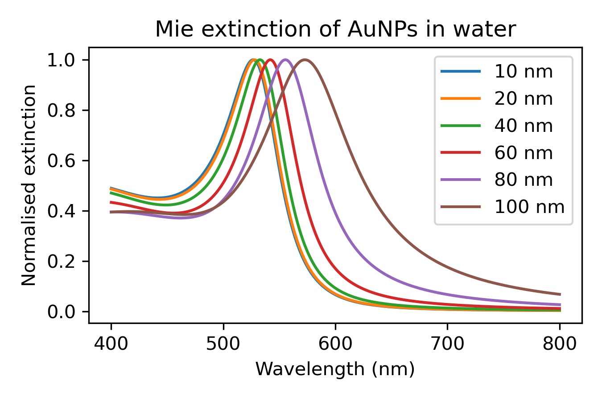
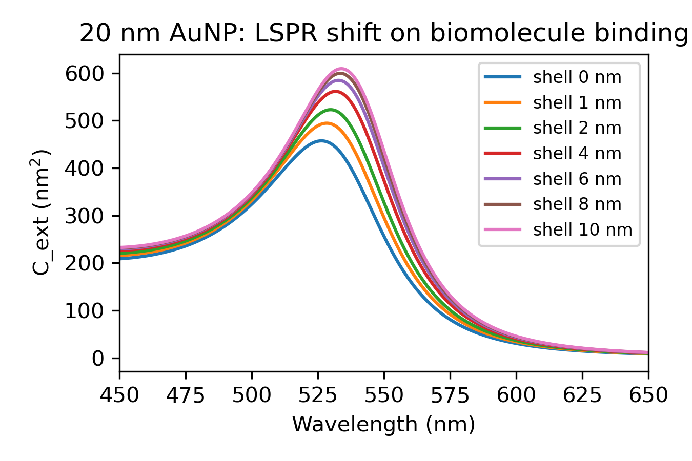
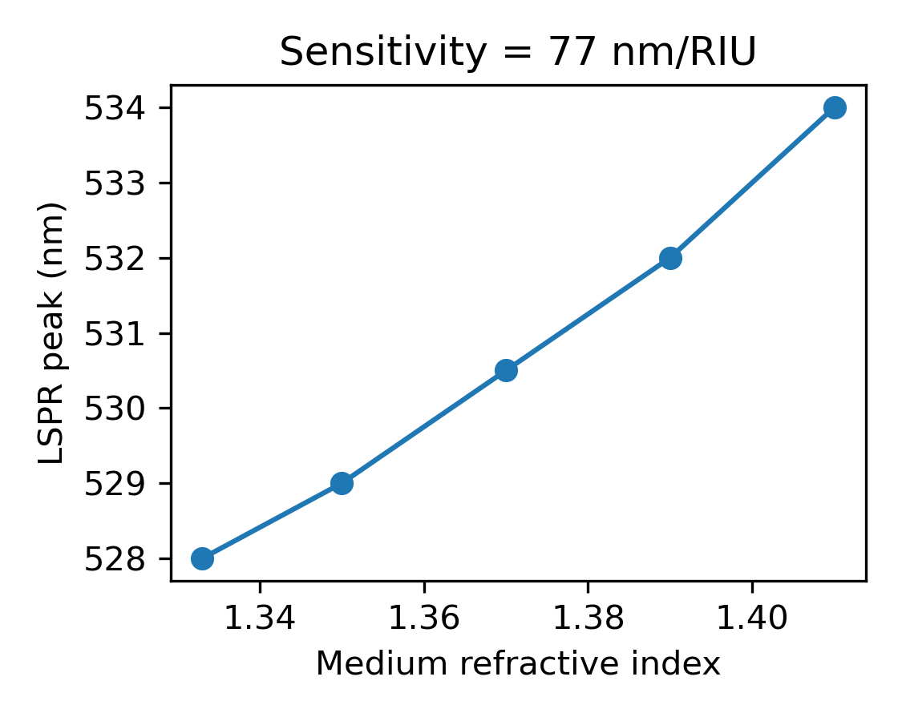
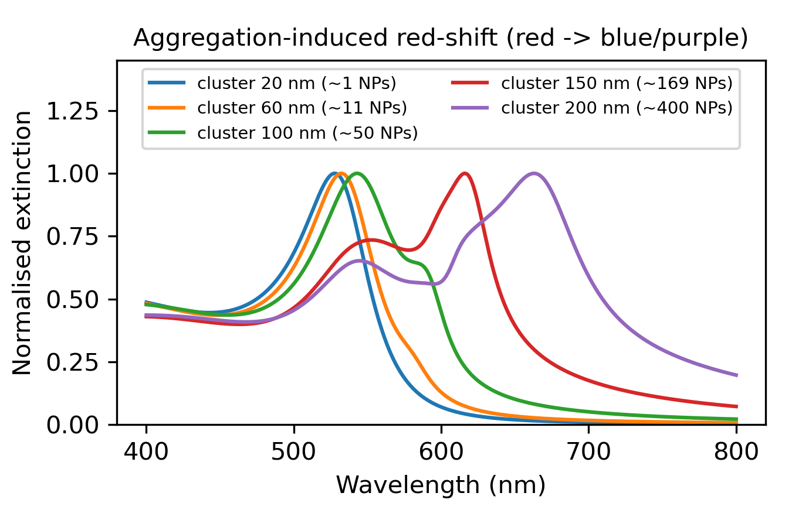
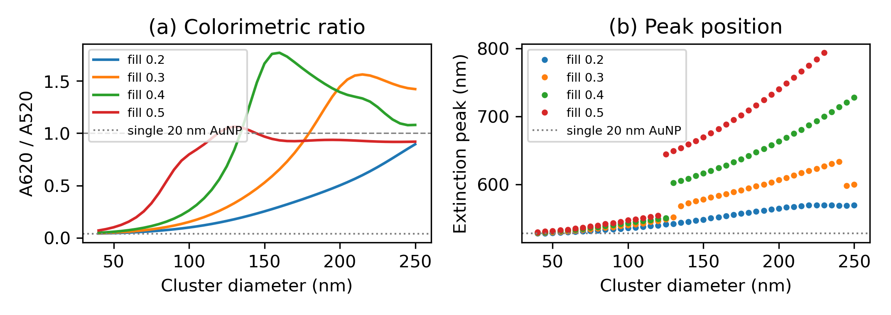
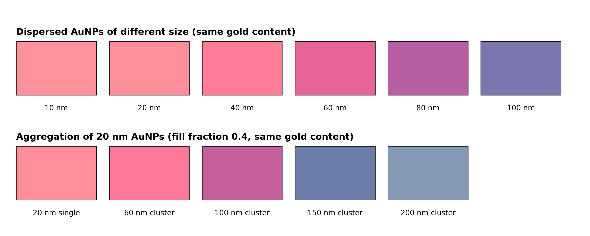
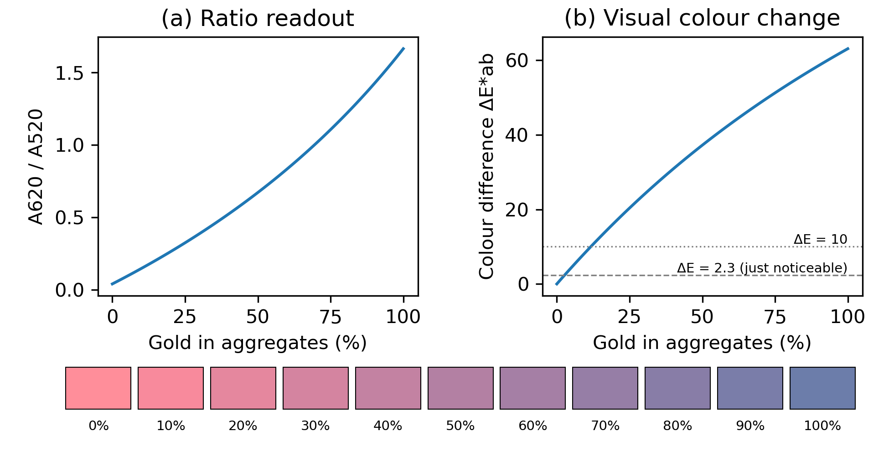

# NanoSense-AuNP

**Computational design of a gold-nanoparticle (AuNP) plasmonic colorimetric biosensor for low-cost point-of-care diagnostics**

Mini-project for **21NT0404T – Nanotechnology in Societal Development**, SRM Institute of Science and Technology, Kattankulathur
Author: **Shreejan V** (RA2311070010025), B.Tech Biotechnology · Guide: **Dr. Karthika P C**, Department of Physics and Nanotechnology

  

---

## Table of contents
1. [Background](#background)
2. [Problem statement](#problem-statement)
3. [How the sensor works](#how-the-sensor-works)
4. [Physics and models](#physics-and-models)
5. [Repository structure](#repository-structure)
6. [Installation and usage](#installation-and-usage)
7. [Results](#results)
8. [Proposed sensor design](#proposed-sensor-design)
9. [Societal impact, safety and ethics](#societal-impact-safety-and-ethics)
10. [Limitations](#limitations)
11. [Future scope](#future-scope)
12. [References](#references)

---

## Background
Bulk gold is yellow, but gold nanoparticles of 10–100 nm in water look **ruby red**. Light drives the particle's conduction electrons into a collective oscillation called the **localized surface plasmon resonance (LSPR)**, which strongly absorbs green light around 520–530 nm. The position of this resonance depends on:

- **particle size and shape**
- **the refractive index right at the particle surface**, which changes when biomolecules bind
- **the distance between particles**: when particles aggregate, the plasmons couple and the colour turns **purple-blue**

This is the principle behind the gold-nanoparticle line in home pregnancy tests and COVID-19 rapid antigen tests, among the most widely used nano-enabled products.

## Problem statement
Laboratory diagnostics such as ELISA, PCR and culture are accurate but need trained staff, instruments, electricity and hours to days. In rural and low-resource settings this delays treatment. A sensor that **changes colour visibly within minutes** would decentralise testing. This project uses physics-based simulation to find which particle size and which readout (binding shift or aggregation) give the strongest, most reliable signal, before any costly synthesis.

**SDG relevance:** SDG 3 (Good Health), SDG 9 (Innovation), SDG 10 (Reduced Inequalities).

## How the sensor works
```
 Antibody/aptamer-coated AuNPs (red, peak ~528 nm)
              │  + target analyte (antigen / DNA)
              ▼
 Analyte cross-links particles → clusters form
              │  plasmon coupling
              ▼
 Peak red-shifts to 600–660 nm → solution turns purple/blue
              │
              ▼
 Read by eye, or by smartphone camera (A620/A520 ratio)
```

## Physics and models
| Component | Model | Why |
|---|---|---|
| Optical response of gold | Analytical Drude + two critical-point dielectric function (Etchegoin et al., 2006) | Reproduces gold's interband transitions in the visible; no lookup tables needed |
| Single-particle spectra | Full **Mie theory** (Bohren & Huffman), Riccati–Bessel functions via SciPy | Exact for spheres of any size; captures size red-shift and broadening |
| Biomolecule binding | Quasi-static **core–shell polarizability** (Au core + protein shell, n = 1.45) | Models the local refractive-index change from an adsorbed antibody layer |
| Bulk sensitivity | Mie theory with medium index n = 1.333–1.41 | Standard sensor figure of merit (nm/RIU) |
| Aggregation | **Maxwell-Garnett** effective medium (Au fill fraction 0.4) + Mie for the cluster | Approximates plasmon coupling and retardation in growing clusters |
| Perceived colour | Beer–Lambert absorbance → **CIE 1931** colour-matching functions (analytic fit, Wyman et al. 2013) → sRGB and **CIELAB** | Turns a simulated spectrum into the colour a user would see, and a colour difference ΔE\*<sub>ab</sub> |
| Dose–response | Mixture of dispersed 20 nm AuNPs and 150 nm clusters, fraction φ of gold aggregated | Links partial aggregation to the ratio readout and to visual detectability |

Key equation (Mie extinction efficiency):

$$Q_{ext} = \frac{2}{x^2}\sum_{n=1}^{\infty}(2n+1)\,\mathrm{Re}(a_n+b_n), \qquad x = \frac{\pi d\, n_m}{\lambda}$$

Aggregation readout: **A620 / A520**, the absorbance ratio used in experimental AuNP assays.

## Repository structure
```
NanoSense-AuNP/
├── nanosense.py          # all models + the four core virtual experiments
├── extended_analysis.py  # dielectric check, absorption vs scattering, sensitivity vs size, gold per test
├── readout_colour.py     # quasi-static vs Mie, cluster size/packing sweep, perceived colour, dose–response
├── figures/
│   ├── fig1_size_spectra.png          # Mie spectra, 10–100 nm
│   ├── fig2_binding_shift.png         # LSPR shift vs protein-shell thickness
│   ├── fig3_ri_sensitivity.png        # peak vs refractive index
│   ├── fig4_aggregation.png           # aggregation-induced red-shift
│   ├── fig5_dielectric.png            # Etchegoin dielectric function of gold
│   ├── fig6_abs_sca.png               # absorption vs scattering, 20/50/80 nm
│   ├── fig7_sensitivity_vs_size.png   # nm/RIU vs diameter
│   ├── fig8_quasistatic_vs_mie.png    # dipole limit vs full Mie peak
│   ├── fig9_aggregation_readout.png   # A620/A520 and peak vs cluster size, 4 packings
│   ├── fig10_colour_swatches.png      # rendered colour of dispersed and aggregated colloids
│   └── fig11_dose_response.png        # ratio and ΔE vs fraction of gold aggregated
├── results/
│   ├── results.csv           # numbers from nanosense.py
│   └── readout_colour.csv    # numbers from readout_colour.py
└── report/
    ├── report.html       # full project report source (SRMIST format)
    └── report.pdf        # rendered 30-page report
```

## Installation and usage
```bash
git clone https://github.com/shreejan-v/NanoSense-AuNP.git
cd NanoSense-AuNP
pip install numpy scipy matplotlib
python nanosense.py           # figures 1–4, results/results.csv
python extended_analysis.py   # figures 5–7, Fröhlich wavelength, scattering fractions, gold per test
python readout_colour.py      # figures 8–11, results/readout_colour.csv
```
`nanosense.py` takes under a minute on a laptop; `readout_colour.py` takes a minute or two because it sweeps 172 cluster configurations. Both extra scripts import the models from `nanosense.py`, which re-runs the four core experiments on import.

To try your own particle, call the functions directly:
```python
from nanosense import mie_qext, WL
q = mie_qext(50, WL)            # 50 nm gold sphere in water
print(WL[q.argmax()])           # plasmon peak (nm)
```

## Results

### 1. Size dependence


| Diameter (nm) | 10 | 20 | 40 | 60 | 80 | 100 |
|---|---|---|---|---|---|---|
| Peak (nm) | 526.5 | 528.0 | 532.5 | 542.0 | 555.5 | 573.0 |
| Max Q<sub>ext</sub> | 0.74 | 1.53 | 3.48 | 5.83 | 7.60 | 7.81 |

The peak barely moves up to 40 nm, then red-shifts and broadens. **20–40 nm particles** give a sharp band with strong extinction, the best choice for colorimetric sensing.

### 2. Biomolecule binding


| Protein shell (nm) | 0 | 1 | 2 | 4 | 6 | 8 | 10 |
|---|---|---|---|---|---|---|---|
| Red-shift (nm) | 0 | 2.0 | 3.5 | 5.0 | 6.5 | 7.0 | 7.5 |

The shift saturates because the plasmon near-field decays within ~10 nm. A spectrometer can detect it, but the eye cannot.

### 3. Refractive-index sensitivity


The peak moves from 528.0 to 534.0 nm for n = 1.333 → 1.41: **≈ 77.5 nm/RIU** for a 20 nm sphere, within the range reported for small spheres.

### 4. Aggregation (the visible colour change)


| Cluster size (nm) | 20 (single) | 60 | 100 | 150 | 200 |
|---|---|---|---|---|---|
| ≈ particles | 1 | 11 | 50 | 169 | 400 |
| Peak (nm) | 528.0 | 532.5 | 543.0 | 616.0 | 663.0 |
| A620/A520 | 0.04 | 0.07 | 0.26 | 1.67 | 1.39 |

Aggregation gives a **>130 nm shift**, more than 15× the binding shift, and a **~40-fold rise in A620/A520**. That makes it the preferred mode for a by-eye or smartphone test. Note that the ratio is lower at 200 nm (1.39) than at 150 nm (1.67): the band has moved past 620 nm (see section 6).

### 5. Validation and extended single-particle analysis (`extended_analysis.py`)
| Check | Result |
|---|---|
| Fröhlich condition Re(ε) = −2ε<sub>m</sub> in water | 518.5 nm |
| Scattering share of extinction at the peak | 0.9% (20 nm), 14.3% (50 nm), 49.8% (80 nm) |
| RI sensitivity vs size | 77.5 (20 nm), 95.3 (40 nm), 116.0 (60 nm), 141.8 nm/RIU (80 nm) |
| Gold in a 100 µL test (OD-1, 20 nm, 7.2 × 10<sup>11</sup> mL<sup>−1</sup>) | ≈ 5.8 µg |

Quasi-static (dipole) vs full Mie peak position (`readout_colour.py`, fig 8):

| Diameter (nm) | 10 | 20 | 30 | 40 | 50 | 60 | 80 | 100 |
|---|---|---|---|---|---|---|---|---|
| Quasi-static peak (nm) | 526.5 | 526.5 | 526.5 | 527.0 | 527.5 | 528.5 | 530.5 | 532.5 |
| Mie peak (nm) | 526.5 | 528.0 | 530.0 | 532.5 | 537.0 | 542.0 | 555.5 | 573.0 |

The two agree within 1.5 nm up to 20 nm, so the Mie code reduces correctly to the dipole limit and the quasi-static binding model (20 nm core) is used inside its valid range. Because the quasi-static peak also sits at 526.5 nm, the 8 nm offset from the Fröhlich wavelength comes from the steep fall of Im(ε) near the interband edge, not from retardation.

### 6. Aggregation readout: cluster size and packing


| Gold fill fraction f | 0.2 | 0.3 | 0.4 | 0.5 |
|---|---|---|---|---|
| Max A620/A520 (cluster size) | 0.89 (250 nm, edge of sweep) | 1.56 (215 nm) | 1.77 (160 nm) | 1.06 (130 nm) |
| Smallest cluster with A620/A520 ≥ 1 | not reached | 180 nm | 135 nm | 120 nm |
| Extinction maximum at D = 200 nm | 564.5 nm | 606.5 nm | 663.0 nm | 740.0 nm |

A620/A520 is a robust yes/no signal (for f ≥ 0.3 every cluster of 150 nm or more is at least 13× the dispersed value of 0.04), but it is **not monotonic in cluster size** and depends strongly on packing. The extinction maximum also jumps between two overlapping bands (550 → 602 nm at D = 130 nm for f = 0.4), so peak position is a discontinuous readout.

### 7. Simulated colour of the colloid


1 cm path, all samples with the same amount of gold as a 20 nm colloid at peak absorbance 1.0 (4.78 × 10<sup>11</sup> particles/mL in this model); 6504 K source mapped to D65 white.

| Sample | λ<sub>max</sub> (nm) | sRGB | L\* | hue h<sub>ab</sub> (°) | ΔE\*<sub>ab</sub> vs 20 nm |
|---|---|---|---|---|---|
| 10 nm | 527 | `#FF929C` | 74.1 | 18 | 1.7 |
| 20 nm (reference) | 528 | `#FF8E9A` | 73.1 | 17 | 0.0 |
| 40 nm | 533 | `#FF7D96` | 68.6 | 11 | 7.9 |
| 60 nm | 542 | `#E86498` | 60.5 | 358 | 22.7 |
| 80 nm | 555 | `#B65EA1` | 52.5 | 335 | 41.4 |
| 100 nm | 573 | `#7C76AE` | 52.3 | 297 | 59.3 |
| 60 nm cluster | 532 | `#FB7899` | 66.6 | 7 | 11.7 |
| 100 nm cluster | 543 | `#C5609D` | 54.7 | 343 | 35.0 |
| 150 nm cluster | 616 | `#6C7DAA` | 52.8 | 281 | 63.1 |
| 200 nm cluster | 663 | `#8699B4` | 62.7 | 267 | 59.3 |

The model reproduces the red → purple → blue change of AuNP aggregation assays from first principles.

### 8. Simulated dose–response and visual threshold


| Gold in aggregates φ (%) | 0 | 5 | 10 | 20 | 50 | 100 |
|---|---|---|---|---|---|---|
| A620/A520 | 0.040 | 0.093 | 0.148 | 0.263 | 0.672 | 1.665 |
| ΔE\*<sub>ab</sub> from negative control | 0.0 | 4.4 | 8.6 | 16.6 | 37.2 | 63.1 |

The ratio rises monotonically with the fraction of gold aggregated, so it can act as a calibration curve. The colour change reaches the just-noticeable difference (ΔE\*<sub>ab</sub> = 2.3) at **φ ≈ 2.6%** (ratio 0.067) and a clearly visible ΔE\*<sub>ab</sub> = 10 at **φ ≈ 11.7%** (ratio 0.166), assuming ideal side-by-side viewing.

### Summary
| Metric | Value |
|---|---|
| Optimal particle size | 20–40 nm |
| Max binding shift (10 nm shell) | 7.5 nm |
| RI sensitivity | ≈ 77.5 nm/RIU (20 nm) to 141.8 nm/RIU (80 nm) |
| Aggregation shift | 528 → 663 nm |
| A620/A520 change | 0.04 → 1.67 (150 nm clusters); max 1.77 at 160 nm |
| Colour (hue angle) | 17° (dispersed) → 281° (150 nm clusters) |
| Gold aggregated for a just-noticeable / clear change | ≈ 2.6% / ≈ 11.7% |

## Proposed sensor design
- **Probe:** 20–40 nm citrate-capped AuNPs (Turkevich synthesis) functionalised with antibodies or aptamers.
- **Format:** single-tube assay or paper strip.
- **Signal:** red → purple/blue within minutes when the target is present.
- **Readout:** visual, or smartphone RGB analysis calibrated against A620/A520.
- **Validation needed:** UV-Vis, TEM, DLS, zeta potential, and tests in real samples.

## Societal impact, safety and ethics
- **Benefits:** fast, cheap (micrograms of gold per test), no electricity needed for a visual read, usable by community health workers.
- **Nanosafety:** AuNPs have low acute toxicity but are biopersistent. Here they stay inside the device, so exposure is low (*Risk = Hazard × Exposure*). Used tests go to biomedical waste.
- **Ethics:** report sensitivity and false results honestly, with no "nano-washing". Smartphone data falls under the DPDP Act 2023. Affordable, open designs help close the nano-divide.
- **Regulation (India):** in-vitro diagnostics are regulated by CDSCO under the Medical Devices Rules 2017. Characterise following ISO/TC 229 and OECD guidance, with safe-by-design choices.

## Limitations
- **Simulation only:** no wet-lab synthesis.
- The quasi-static shell model ignores retardation (fine for the 20 nm core used, not for larger cores).
- The bulk dielectric function has no size-dependent surface damping, so bands of 10–20 nm particles come out slightly too narrow and strong.
- Maxwell-Garnett clusters approximate real fractal aggregates, and the readout depends strongly on the assumed packing.
- The colour model (analytic colour-matching functions, blackbody source, CIE 1976 ΔE) and the two-state dose–response are approximations; visual thresholds assume ideal viewing.
- Real samples cause non-specific aggregation, which is not modelled.

The trends are reliable, but the absolute numbers are approximate.

## Future scope
- Wet-lab synthesis and experimental validation
- Nanorods and nanostars for higher sensitivity
- DDA/FDTD simulation of realistic aggregates
- ML-based smartphone colour-reader app
- Multiplexed strips for several diseases

## References
1. G. Mie, *Annalen der Physik* 330, 377 (1908).
2. C. F. Bohren & D. R. Huffman, *Absorption and Scattering of Light by Small Particles*, Wiley (1983).
3. P. B. Johnson & R. W. Christy, *Phys. Rev. B* 6, 4370 (1972).
4. P. G. Etchegoin, E. C. Le Ru & M. Meyer, *J. Chem. Phys.* 125, 164705 (2006).
5. C. A. Mirkin et al., *Nature* 382, 607 (1996).
6. R. Elghanian et al., *Science* 277, 1078 (1997).
7. S. Link & M. A. El-Sayed, *J. Phys. Chem. B* 103, 4212 (1999).
8. W. Haiss et al., *Anal. Chem.* 79, 4215 (2007).
9. K. A. Willets & R. P. Van Duyne, *Annu. Rev. Phys. Chem.* 58, 267 (2007).
10. P. K. Jain et al., *J. Phys. Chem. B* 110, 7238 (2006).
11. G. A. Posthuma-Trumpie et al., *Anal. Bioanal. Chem.* 393, 569 (2009).
12. J. Turkevich et al., *Discuss. Faraday Soc.* 11, 55 (1951).
13. J. C. Maxwell Garnett, *Phil. Trans. R. Soc. Lond. A* 203, 385 (1904).
14. C. Wyman, P.-P. Sloan & P. Shirley, *J. Comput. Graph. Tech.* 2(2), 1 (2013).
15. M. Mahy, L. Van Eycken & A. Oosterlinck, *Color Res. Appl.* 19, 105 (1994).
16. IEC 61966-2-1:1999, Default RGB colour space – sRGB.

The full report (`report/report.pdf`) cites 25 references.

---
*Academic mini-project. All results in this README come from running `nanosense.py`, `extended_analysis.py` and `readout_colour.py`.*
